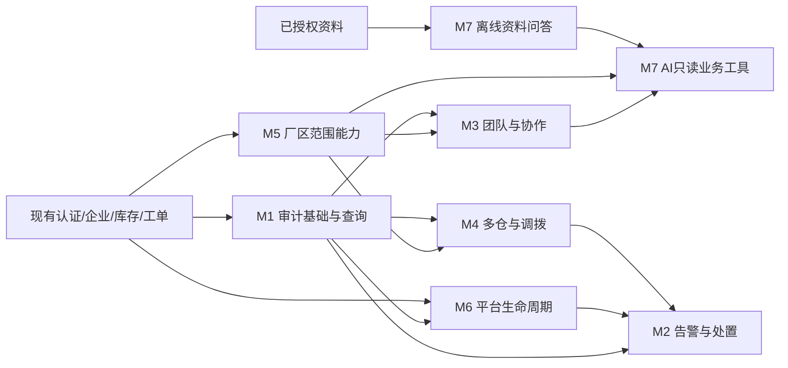

# 七模块产品需求文档（PRD）总体框架

日期：2026-11-03。文档阶段一。状态：供审阅的新增设计，不代表实现、测试通过或开工授权。

## 1. 阅读顺序与范围

| ID | 模块 | 当前核对结果 | 目标 |
|---|---|---|---|
| M1 | 权限与关键操作审计查询 | 已有工单日志；不等于统一审计 | 对敏感变更可追溯、可授权查询 |
| M2 | 监控告警与故障处置 | 已有请求编号、日志轮转、受控health及恢复证据 | 可发现异常、确认责任、恢复闭环 |
| M3 | 维修团队与跨团队协作 | 团队及移交属于新增规划 | 团队维护、受控改派、责任连续 |
| M5 | 厂区管理与成员厂区授权 | SiteController已有GET列表/详情、POST/PUT；当前列表仍默认厂区语义 | 全业务统一受厂区范围限制 |
| M6 | 平台企业生命周期管理 | 企业成员管理已有，平台身份尚属规划 | 受控开通/暂停/恢复企业 |
| M7 | Python AI维修知识助手 | 31号候选规划，未实现 | 有来源资料问答，再接只读业务工具 |

这七项不包括二维码打印等验收尾项，也不自动纳入SSO、采购、SLA或消息队列。

## 2. 业务背景与目标

现有系统已覆盖企业、设备、工单、备件、库存、维护及导出。多厂区、多团队、多仓库协作需要更细授权和跨仓库存追踪；权限变更及平台动作需要审计；健康信息需要转为可处置事件；维修知识可通过有引用的只读助手辅助查询。

| 目标 | 可验收结果（非已达成数字） |
|---|---|
| G1 协作与授权 | 两企业、多厂区/仓库/团队场景，越权入口及动态撤权全部符合43号矩阵 |
| G2 库存守恒 | 每次调拨源仓减少、在途变化、目标仓增加相互对应；失败无半写 |
| G3 可追溯与可处置 | 指定变更查到审计；告警有去重、责任、恢复时间线 |
| G4 AI有依据 | 回答引用真实授权片段；无依据拒答，不能改库存/工单 |

## 3. 角色与权限原则

沿用当前角色枚举，不擅增“仓库主管”等数据库角色。普通有效成员只读其获授权业务；企业管理员维护团队、厂区、仓库及授权，调拨/改派的首版写操作建议仅管理员。现有工单技师/验收规则保持，具体动作权限在对应迭代前确认。平台运营身份独立于企业管理员；运维身份不默认取得企业业务权限。AI是辅助程序，不是拥有权限的用户。

默认方案：新增细粒度授权后企业管理员可管理本企业全厂区；普通成员仅限显式分配厂区。存量成员迁移前必须展示回填方案，不能上线后把“无记录”解释成全厂区。平台权限不自动授予业务明细访问。

## 4. 模块边界与依赖关系图

箭头表示前置能力供下游使用，不代表可以绕过服务直接改表。

M1写入基础应早于其他敏感变更；M2最小告警可独立推进。M7离线原型不依赖团队/调拨，真实业务工具必须接入最终厂区及平台停用规则。

## 5. 每模块需求与边界

| 需求ID | 必须交付 | 排除项/业务边界 |
|---|---|---|
| M1-R1 | 记录操作者、企业、动作、对象、结果、时间、请求号及脱敏变更摘要；管理员筛选查询详情 | 不记录密码、令牌、全文正文；不是业务事件回放平台 |
| M1-R2 | 成功变更审计和业务同事务；拒绝/失败事件独立且不能伪记成功 | 审计写入失败时敏感写操作回滚；只读请求不全量写审计 |
| M2-R1 | 固定规则检测应用不可用/任务失败等，OPEN→ACKNOWLEDGED→RESOLVED；责任和通知记录 | 首版站内通知；外部渠道待确认，不自动发送邮件/短信 |
| M2-R2 | 相同指纹合并、冷却、恢复事件、处置记录 | 不用单次请求失败直接宣称系统故障 |
| M3-R1 | 团队启停、有效成员、工作厂区；管理员增删成员 | 团队权限只能收窄，不能扩大个人厂区授权 |
| M3-R2 | PENDING或IN_PROGRESS工单受控改派，必须填原因，条件更新+日志+审计 | AWAITING_ACCEPTANCE/COMPLETED不改派；保留历史操作者、用料、验收分离 |
| M4-R1 | 多仓维护、启停、余额查询；有余额/在途关联不能停用或迁移归属 | 不改现有默认仓库GET契约，不物理删有历史仓库 |
| M4-R2 | 单备件单行调拨申请、出库、完整收货、出库前取消，幂等和流水关联 | 首版不做多行/部分收货/自动补偿；异常只挂起和登记，不凭备注平账 |
| M5-R1 | 厂区维护，成员可访问厂区集合管理及动态生效 | 设备、工单、库存、统计、导出、后台任务和AI均不能漏限制 |
| M5-R2 | 跨厂区调拨必须有源/目标范围，团队资格与成员范围取交集 | 企业切换不能继承另一企业范围 |
| M6-R1 | 平台专属权限开通企业、暂停、恢复，原因必填，状态及审计同事务 | 不物理删企业；暂停不删除会话数据或业务数据 |
| M6-R2 | 暂停后业务后续请求/后台批次/下载授权拒绝，恢复后重新核验 | 不承诺撤回已下载文件或立即终止已提交事务 |
| M7-R1 | Markdown/TXT资料入库、版本/片段来源、带引用问答、不足拒答及删除重建索引 | PDF/OCR、自动诊断、业务写入、预测性维护后置 |
| M7-R2 | Java授权后白名单只读工具，有限次数/时间/Token预算，企业隔离 | Python不直连业务MySQL，不执行模型SQL，不默认上传真实企业资料 |

## 6. 产品约束与待确认项

开始相关迭代前确认：厂区存量回填及管理员范围；调拨操作角色、损耗/退运是否另开后续版本；团队移交适用状态；平台运营账号产生及应急流程；通知渠道/值守责任/保留期限；AI资料许可、模型预算/供应商/出域范围。以上未确认项不能直接转成生产写入规则。

关联：[里程碑](39-七模块项目迭代与里程碑计划.md)、[SAD](40-七模块系统架构设计SAD.md)、[数据设计](41-七模块数据模型与数据库设计ER.md)、[接口UI](42-七模块接口与UIUX规范.md)、[质量](43-七模块质量与测试规划.md)。
