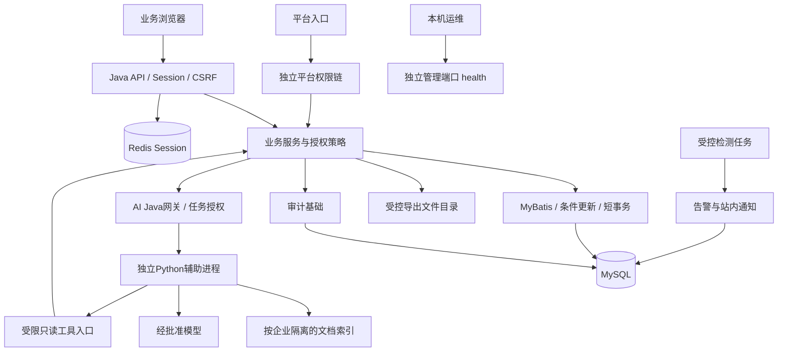
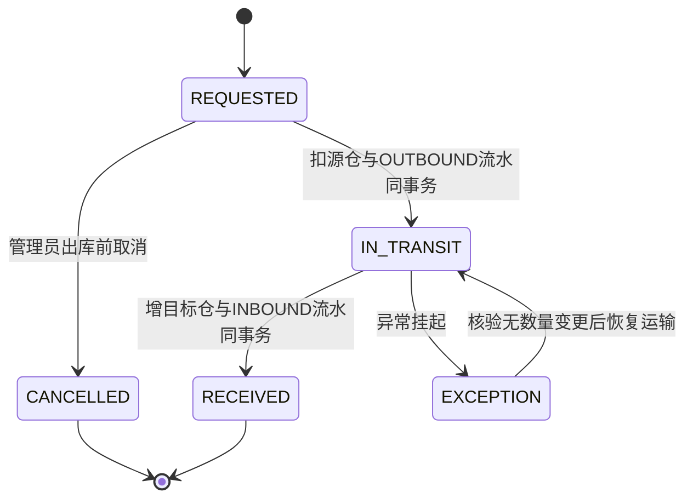

# 七模块系统架构设计文档（SAD）

日期：2026-11-03。文档阶段二。供审阅设计；不代表新组件已部署。

## 1. 现有架构基线与决策

源码核对：Java17、Spring Boot4.0.6、MyBatis-Plus、MySQL/Flyway、Redis Session、Vue前端；已有导出任务/本地受控共享目录，以及ops管理端口和日志配置。现有WorkOrderStatus为PENDING、IN_PROGRESS、AWAITING_ACCEPTANCE、COMPLETED；InventoryReferenceType尚无调拨枚举。保持主系统单体，不拆业务微服务、不新增MQ/分布式事务。新方案只用增量迁移，不改已执行Flyway文件。

## 2. 系统架构与信任边界

浏览器tenantId/userId仅是选择或输入，不构成授权；当前企业来自服务端Session。Python不读业务数据库；模型返回的工具名/参数不构成执行权限。管理健康端口不得代理公开。外部模型调用是数据出域边界，未批准不得传真实资料。

## 3. 七模块内部职责

| 模块 | 服务职责 | 与其他模块协作 |
|---|---|---|
| M1 | 审计追加、脱敏、受控分页 | 敏感变更事务内追加；失败事件独立记录 |
| M2 | 固定规则采样、事件去重、通知及恢复 | 独立租约/条件更新防多实例重复，读取受控指标 |
| M3 | 团队资格和改派编排 | 与M5范围求交；工单状态条件更新+日志+审计 |
| M4 | 调拨状态/余额/流水 | 复用库存规则，不复制库存真相；M5校验两个仓库 |
| M5 | 返回允许厂区集合及单对象范围校验 | 现有查询SQL、汇总、导出、后台逐项接入，权限变更不依赖旧Session快照 |
| M6 | 平台权限、企业状态变更 | 每次请求及后台批次重新检查企业状态；平台不能默认查业务 |
| M7 | Java任务授权/工具白名单，Python检索生成 | 文档/索引/会话/引用均按企业隔离；禁止任意SQL与写工具 |

候选内部接口：requireVisibleSiteIds(actor,tenant)、requireSiteAccess(actor,tenant,site)、appendAudit(event)、dispatchTransfer(command)、invokeReadonlyTool(context,tool,args)。这是职责示意，不是已创建的方法，不大改CurrentAccessService现有签名。

## 4. 关键流程与事务

### 4.1 调拨单行首版

申请不预占，出库时条件扣减，库存不足409。一次事务内：可信身份/两端范围→锁单据→期望状态/版本→库存条件更新→唯一流水→状态→审计。收货同理。固定锁顺序：单据→按仓库ID排序的库存记录；每条入口都遵循，死锁只有限重试并复核幂等。源仓扣减与目标入库分属不同业务时点，靠在途数量和不可跳转状态守恒，不用跨运输期间长事务。

异常不自动加减库存；丢失、报损、退运需要独立后续业务确认，首版EXCEPTION保持在途责任，禁止直接标为已收货。幂等键同号异内容409，同号同内容重放已保存结果。

### 4.2 厂区撤权与改派

授权更新与审计同事务；每次请求重新取范围，后台显式userId+tenantId并每批重查。数据库SQL同时限定tenant和允许site；详情和关联检查同样适用。改派条件匹配原负责人、状态和version，失败409，不能用先查后无条件覆盖。已开始请求与撤权的精确并发生效边界在对应事务设计明确；不承诺撤回已交付字节。

### 4.3 平台暂停

平台角色独立校验→锁企业/版本→更新ACTIVE/SUSPENDED→审计→提交。后续登录/企业选择/业务入口/后台批次/下载授权统一拒绝。任务不承诺自动恢复，停用导致失败的任务应由用户重新提交；恢复企业不恢复已撤销成员。

## 5. 可靠性与安全

业务审计与应用日志分开；请求编号用于定位，taskId用于异步生命周期。后台任务使用显式身份、有限队列/超时/资源清理；不复制SecurityContext或Session。通知失败记录状态/重试次数/下次时间，有限退避，多实例通过条件领取；不把消息送达与业务提交绑为长事务。

AI先离线固定检索→生成，后工具调用；LangGraph/MCP只有真实需求才引入。每任务限长度、时间、调用次数和预算；具体默认值在模型/环境选型后冻结。服务间候选方案为Java签发短期任务凭证，绑定audience、tenant/user/task、scope、jti/expiry，TLS或同机受控通道；工具端重查权限/状态，防重放策略必须单独验收，不能仅凭自报请求头授权。

## 6. 部署与演进

沿用37号启动约定；共享Redis不代表文件/AI索引共享。新增表先迁移评审，再隔离演练；新增API与现有默认列表保持兼容。厂区授权采用“回填→范围服务→各入口接入→完整验证→启用”顺序，禁用开关不能变成允许绕过授权的接口参数。AI进程失败不阻断工单与库存。

未决ADR：通知渠道、平台账号治理、AI模型与向量存储、授权存量回填、异常调拨结算。未确认不得新增依赖、收费调用或自动写入。
