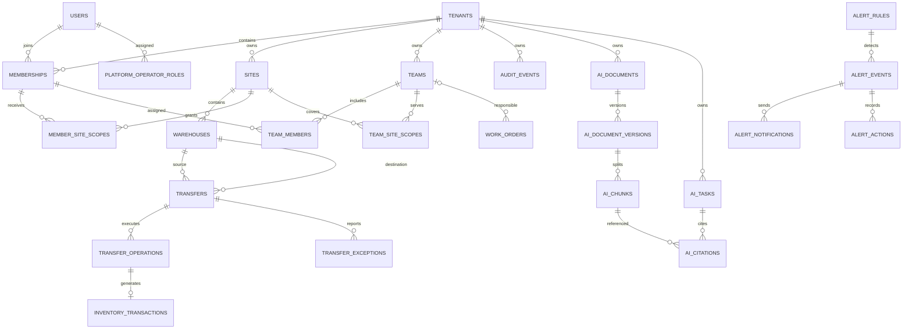

# 七模块数据模型与数据库设计（ER）

日期：2026-11-03。文档阶段二。以下为逻辑模型与候选物理结构，不是可直接执行DDL。现有表名/字段以Entity、Flyway和实际目标schema三方核对为准，禁止据本文直接建表或改历史迁移。

## 1. 基线与建模约定

复用users、tenants、tenant_memberships、sites、warehouses、equipment、work_orders、warehouse_stock、inventory_transactions、work_order_logs、inventory_export_tasks等现有对象。新企业表实体字段及enabled语义需先核对，不直接把ACTIVE/SUSPENDED字符串写进当前布尔字段。

所有新增企业业务表有tenant_id；BIGINT ID对前端序列化为字符串；数量DECIMAL(14,3)，必须>0，不能浮点计算。时间统一数据库/应用约定，接口ISO8601带偏移量，页面上海时间；存量DATETIME不批量变更。业务编号企业内唯一；引用必须校验同tenant，可用(tenant_id,id)唯一键+复合外键强化，数据库限制无法表达的范围交集由服务保证。新索引基于查询模式设计，实施时EXPLAIN，不预填性能收益。

## 2. ER总览

图中大写名为逻辑实体；TEAM等及AI/告警/审计表尚未创建。WAREHOUSES对TRANSFERS两条关系代表两个不同外键列，不能合并成任意仓库关系。

## 3. 候选数据字典

公共字段：id BIGINT、created_at/updated_at DATETIME(6)；需并发修改的主表含version BIGINT NOT NULL默认0。下表给出新增业务列，非全量DDL。

| 模块/候选表 | 主要字段（类型/意义） | 唯一与查询索引 |
|---|---|---|
| M1 audit_events | tenant_id可空仅平台事件；actor_user_id、actor_type、action VARCHAR64、object_type/id、outcome、request_id VARCHAR36、changes_json JSON、occurred_at | tenant+occurred_at+id；tenant+object_type+object_id；按实际操作者查询增补 |
| M2 alert_rules | scope_type、tenant_id可空、code、metric、operator、threshold DECIMAL、window_seconds、cooldown_seconds、enabled、owner_user_id | scope_key+code唯一，scope_key非空避免NULL唯一漏洞 |
| M2 alert_events | rule_id、scope_key、fingerprint、state、first_seen/last_seen/acknowledged/resolved_at、count、version、open_slot | fingerprint+open_slot唯一；活动open_slot=1，已解决NULL允许历史多条；状态/最近发生索引 |
| M2 alert_notifications | event_id、recipient_id、channel、delivery_key、state、attempts、next_attempt_at、safe_error_code | delivery_key唯一；state+next_attempt_at |
| M2 alert_actions | event_id、actor_id、action、safe_note、created_at | event_id+id |
| M3 teams | tenant_id、team_code/name、enabled、version | tenant+team_code唯一 |
| M3 team_members | tenant_id、team_id、membership_id | tenant+team_id+membership_id唯一 |
| M3 team_site_scopes | tenant_id、team_id、site_id | tenant+team_id+site_id唯一 |
| M3 work_orders扩展 | 可空team_id、version（若已有则复用） | 按tenant+team_id+status+id候选 |
| M4 transfers | tenant_id、transfer_no、source_warehouse_id、target_warehouse_id、spare_part_id、quantity、status、created_by、dispatched_by/received_by、对应时间、version | tenant+transfer_no唯一；tenant+status+created_at+id；两端仓库查询索引 |
| M4 transfer_operations | tenant_id、transfer_id、action、request_id、payload_hash、result_status、transaction_id可空 | tenant+request_id唯一；transfer+action对DISPATCH/RECEIVE各一次 |
| M4 transfer_exceptions | tenant_id、transfer_id、reason_code、note、opened_by、resolved_by、state、created_at/resolved_at | tenant+transfer_id+id |
| M5 tenant_member_site_scopes | tenant_id、membership_id、site_id、granted_by | tenant+membership_id+site_id唯一 |
| M6 platform_operator_roles | user_id、role_code、enabled、granted_by、granted_at | user_id+role_code唯一，不使用企业成员角色代替 |
| M6 platform_tenant_actions | tenant_id、actor_user_id、action、reason、before_state/after_state、request_id、version | tenant_id+created_at+id；关联平台审计 |
| M7 ai_documents | tenant_id、document_code、title、state、created_by | tenant+document_code唯一 |
| M7 ai_document_versions | tenant_id、document_id、version_no、content_hash、storage_key、index_state | tenant+document_id+version_no唯一 |
| M7 ai_chunks | tenant_id、version_id、chunk_no、section、content_hash、index_ref | tenant+version_id+chunk_no唯一；向量索引同样强制企业过滤 |
| M7 ai_tasks | tenant_id、created_by、request_id、state、model_ref、input/output_tokens、cost、error_code、expires_at | tenant+created_by+created_at+id；tenant+request_id唯一 |
| M7 ai_citations | tenant_id、task_id、chunk_id、citation_no | tenant+task_id+citation_no唯一 |

AI正文/问题是否存库、加密/删除期限须确认；默认不记录完整对话，成本币种与精度在供应商选定后冻结。索引可重建，不能把向量库当资料和授权唯一真相。

## 4. 库存与状态约束

库存真相仍在warehouse_stock与不可随意编辑的inventory_transactions；调拨需评审新增referenceType=TRANSFER及transfer关联列/操作唯一键，不复用工单领料类型伪装调拨。新枚举需同步Entity/XML/DTO/前端及数据库约束。

申请数量q：REQUESTED/CANCELLED无库存影响；IN_TRANSIT/EXCEPTION时源仓累计减少q，在途q，目标未增；RECEIVED时源仓减少q、目标增加q、在途0。任意时刻本次调拨的源变化+目标变化+在途变化=0。相同动作不能产生第二条有效流水。

源仓≠目标仓、两端及备件同企业、有效且操作者两端可见；操作记录与库存/状态同事务。首版没有部分收货，EXCEPTION不可凭文字改变余额；恢复运输仅改变挂起状态，不结算损失。

## 5. 数据生命周期、迁移与回退

1. 先只读核对实际最高迁移版本，文件编号实施时分配，不预定V13且不改V1—V12。
2. 备份现有结构/数据并校验目标；新增表/可空关联列/索引，存量回填先产出映射预览。
3. 厂区范围回填应按真实业务和用户确认，默认厂区不意味着自动拥有所有厂区；启用新范围前全面验证。
4. 禁止物理删除有业务引用的仓库/厂区/团队/企业；先停用并检查未完成单据、非零库存和有效成员。
5. 审计追加只读；保留/归档期限需签定，不默认无限保存。AI删资料需删除可检索索引、撤销引用访问、清理缓存，历史引用显示已删除而不泄露原文。
6. 回退先停新写入并确认旧代码兼容；有调拨流水后不能DROP表或删除历史还原。必要时采用前向修复，不能将源码回退等同库存回退。
