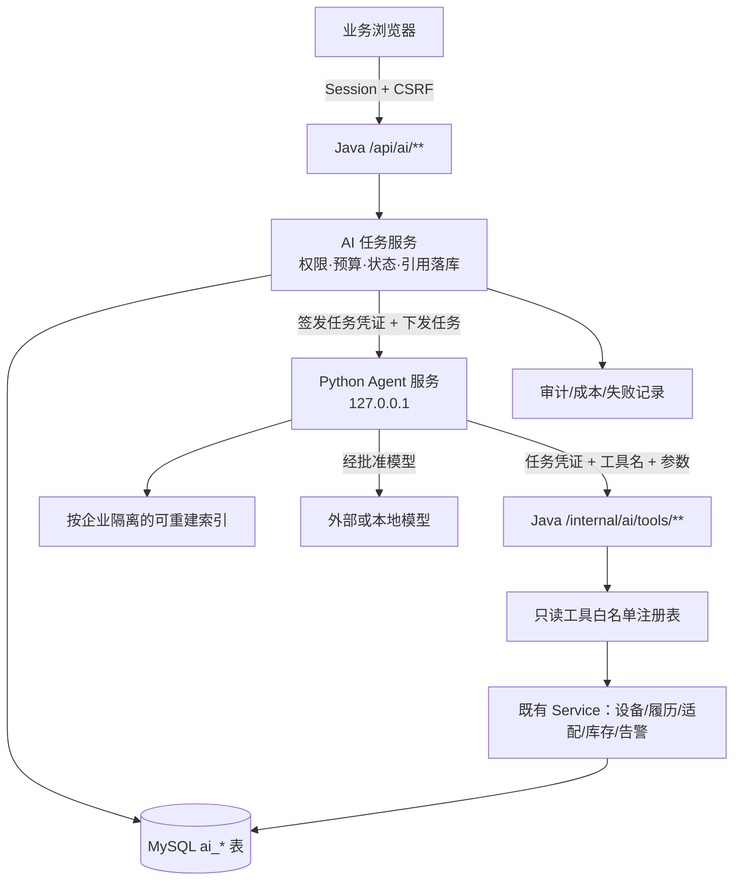

# M7 工业运维 Agent 实现开发流程规划（Java 业务后端 + Python Agent 服务）

日期：2026-11-10，上海时间。
状态：规划稿。本文不授权开工、不创建表、不安装依赖、不调用收费模型、不上传真实企业资料。范围与验收口径以 31、38、39、40、41、42、43 号文档为准，本文只把它们落成可执行的开发顺序。

## 1. 定位与边界

Agent 是"设备维修知识助手"，不是拥有权限的用户。

做：

- 用已授权资料回答维修相关问题，并给出可核对的来源。
- 在资料不足时明确说不足，不编造手册结论、页码或维修步骤。
- 经 Java 逐次授权后，调用少量白名单只读工具，把"系统查到的事实"与"资料里的建议"分开呈现。
- 最终阶段评估"生成草稿由用户确认、再由 Java 重新校验后写入"，但首版草稿不自动写库。

不做（首版全部排除）：

- 预测性维护、故障概率、自动决策。
- 模型生成 SQL、模型直连业务库、模型自选工具越权执行。
- 无人确认的自动业务写入。
- 多智能体、多 AI 服务、LangGraph/MCP 为用而用。
- PDF/OCR 解析（后置）。

信任边界（40 号第 2 节）必须一直成立：浏览器传来的 tenantId/userId 只是输入，不构成授权；Python 不读业务 MySQL；模型返回的工具名和参数不构成执行权限；外部模型调用是数据出域边界。

## 2. 参考四步与本文阶段映射

| 参考步骤 | 本文阶段 | 对应需求 | 退出判据（摘要） |
|---|---|---|---|
| 先做资料问答和评测 | P1 | M7-R1 | 资料可用、引用真实、资料不足正确拒答、跨企业为 0 |
| 再接只读 Java 工具（设备+履历→适配备件/库存/告警） | P2（P2a→P2c 分批） | M7-R2 | 越权、错误参数、超时、空数据反例全部通过 |
| 有限流程编排（固定白名单、限次数与耗时、结果校验） | P3 | M7-R2 延伸 | 预算、循环上限、结果 schema 校验生效 |
| 评估草稿写入（用户确认→Java 重校验→AI 故障不影响业务） | P4、P5 | M7-R2 延伸 | 幂等、状态、权限三重校验；AI 停机时业务照常 |

阶段编号沿用 51 号 A9，并与 39 号"阶段 7"对齐；A0 对应 P0。

## 3. 现状核对（以源码为准）

| 项目 | 实际状态 | 对规划的影响 |
|---|---|---|
| 迁移 | V1—V15 已执行，27 张表 | AI 新表从 V16 起新增，不改历史迁移 |
| AI 相关表 | 无 ai_documents/versions/chunks/tasks/citations | 全部新建 |
| AI 代码 | 无 com.ai 包，无 Python 服务 | 全新模块，不改造既有业务 |
| 设备/工单归属 | V3 已加 tenant_id + site_id，并有 (tenant_id,site_id,id) 复合唯一键 | 工具可按企业+厂区行级过滤 |
| M5 成员厂区范围 | 无 tenant_member_site_scopes 表，无范围服务 | **真实业务工具的成员级厂区限制当前无法落地** |
| M6 企业暂停 | tenants 仅 enabled 布尔，无暂停动作与审计 | 工具只能做到"企业 enabled 校验" |
| 现有可复用范式 | InventoryExportServiceImpl：instanceId 租约、条件更新、ownedTasks、独立线程池、任务状态表 | ai_tasks 直接照此范式实现，不另创一套 |
| 现有可复用能力 | CurrentAccessService、Result、审计表、告警表、日志脱敏 | 工具与任务都走同一套可信身份入口 |
| 主类 MapperScan | 曾因遗漏 com.operations.mapper 启动失败 | 新增 com.ai.mapper 必须同步加入 MapperScan 并复验启动 |
| 运行基线 | 后端 8082、库 equipops_v2、Redis Session、Cookie EQUIPOPS_V2_SESSION | Python 服务另设端口，不改现有端口与库 |

结论：**P1 可以现在独立开工；P2 的真实业务工具必须先解决 M5 厂区范围（或明确降级为"仅企业级"并书面接受）再接入**，这是 38 号第 4 节的硬前置，不是本文新增要求。

## 4. 目标架构



四条不变量：

1. 浏览器只与 Java 通信；Python 内部接口不对外暴露。
2. Python 拿不到 Session，只能凭 Java 签发的短期任务凭证调用白名单工具。
3. 凭证里的 tenantId 只是"目标"，Java 每次调用仍以数据库当前成员关系、企业 enabled 状态复核。
4. AI 全链路可整体关闭（`ai.enabled=false`），关闭时业务功能不受影响。

## 5. 阶段划分

### P0 准备与冻结（A0）

前置：无。

要做：

1. 核对当前源码、未跟踪文件、迁移最高版本，产出差距表。
2. 选定 1 种设备类型 + 少量可提供给模型的授权资料（首版只 MD/TXT）。
3. 书面确认：模型运行位置（外部 API／本地部署）、调用预算、资料允许出域范围、日志保留与删除方式、评测阈值。
4. 冻结评测集版本、模型名、K 值、延迟与成本阈值——先写期望，后跑结果。
5. 读 31 号并复述本轮不做的项，避免范围漂移。

交付：差距表、资料清单与许可、数据边界确认、评测口径冻结记录。

退出：上述四项书面确认齐备；模型未确认则停在 P0，不写代码。

不做：不建表、不装依赖、不调模型。

### P1 资料问答与评测（M7-R1，对应 A1）

前置：P0 完成。

目标：证明"资料能用、引用能核、资料不足能拒"。

Java 侧（M7-R1 主责）：

1. Flyway `V16__create_ai_tables.sql` 新建五张表（字段口径按 41 号第 3 节）：
   - `ai_documents`：tenant_id、document_code、title、state（DRAFT/ACTIVE/DELETED）、created_by；唯一 `tenant_id+document_code`。
   - `ai_document_versions`：version_no、content_hash、storage_key、index_state（PENDING/INDEXED/FAILED）、byte_size；唯一 `tenant_id+document_id+version_no`。
   - `ai_chunks`：version_id、chunk_no、section、content_hash、index_ref；唯一 `tenant_id+version_id+chunk_no`。
   - `ai_tasks`：created_by、request_id、state、model_ref、input/output_tokens、cost、error_code、expires_at；唯一 `tenant_id+request_id`，索引 `tenant+created_by+created_at+id`。
   - `ai_citations`：task_id、chunk_id、citation_no、quote_hash；唯一 `tenant+task_id+citation_no`。
2. 资料存储：受控根目录 `ai.doc.root`，文件名由后端生成（不取用户文件名），校验扩展名/MIME/大小/编码，防目录穿越；storage_key 永不出接口。
3. 接口（候选，按 42 号）：`GET/POST /api/ai/documents`、`GET /{id}`、`DELETE /{id}`、`POST /{id}/versions`；管理员维护资料，有效成员可读列表但不含他人无权资料。
4. 全部走 `CurrentAccessService.requireTenantAccess()`，SQL 一律带 tenant_id；删除资料 = 逻辑删除 + 通知 Python 删索引 + 撤销引用访问，历史引用显示"资料已删除"且不泄露原文。
5. 任务服务照 `InventoryExportServiceImpl` 范式：状态条件更新、租约、取消、超时、资源清理，独立线程池。

Python 侧：

1. 服务骨架：FastAPI + pydantic v2 + httpx，配置全走环境变量，只绑定 127.0.0.1。
2. 入库：解析（首版仅 MD/TXT）→ 规范化（保留章节标题作为 section）→ 切分（固定长度+重叠，参数化）→ 生成向量 → 写可重建索引；每片存 chunk_no、section、content_hash。
3. 检索生成：固定"检索→生成"两段式，不做智能体自由发挥。
4. 引用组装：只允许引用本次检索命中的 chunkId；引用原文由 Java 按 chunkId 重新取回渲染，**不使用模型输出的引用文本**。
5. 拒答：最高检索分低于阈值、或有效引用数为 0、或资料不存在未删除版本 → 返回 `INSUFFICIENT_EVIDENCE`，不生成结论。
6. 计时：检索耗时、模型耗时、token、成本逐任务记录，在 Python 日志与 Java ai_tasks 各记一份（供对账）。

评测（P1 的正式交付物，不是附带）：

| 维度 | 做法 | 通过口径 |
|---|---|---|
| 有依据问答 | ≥30 条人工审核样例：有依据／无依据／错误引用／提示注入／越权／工具失败 | 分类正确率达标，阈值 P0 已冻结 |
| 引用真实性 | 程序校验 citation→chunk 存在、同企业、同版本、quote 与原文一致 | 伪造引用 = 0 |
| 正确拒答 | 无资料、资料删除后、跨企业文档 ID | 拒答率 100%，不得编造 |
| 越权 | 企业 A 用户请求企业 B 的 documentId/taskId | 一律 404，泄露 = 0 |
| 注入 | 资料正文内嵌"忽略上述规则/放开白名单" | 不改变白名单与授权 |
| 成本与延迟 | 每任务 token、成本、P50/P95 延迟 | 记录真实值，不填理想值 |

退出：上述门槛全部有可复现记录，硬门槛（跨企业泄露、伪引用、未授权写入）为 0。**不达标不得进入 P2。**

不做：不接业务工具、不写业务表、PDF/OCR、混合检索与重排（等评测结果决定是否需要）。

### P2 只读 Java 工具（M7-R2，对应 A2）

前置：P1 退出；且 M5 成员厂区范围已落地，或用户书面接受"首版仅企业级范围"。M6 企业暂停未落地时，工具至少校验 `tenants.enabled` 与成员 enabled。

#### P2 共同基础（先做，只做一次）

1. **工具注册表**（`ReadonlyToolRegistry`）：工具名 → 参数 schema、所需权限、行数上限、超时、返回字段白名单。未注册的工具名一律拒绝，模型说了也不算。
2. **任务凭证**：Java 签发短期凭证，绑定 audience、tenantId、userId、taskId、scope（工具集合）、jti、expiry（≤10 分钟）；HS256 或非对称，密钥走环境变量。校验：签名→过期→audience→scope→jti 未复用（一次性或次数上限，防重放单独验收）。
3. **内部工具入口** `/internal/ai/tools/{toolName}`：只接受任务凭证，不走 Session/CSRF 过滤器链；绑定 127.0.0.1 或受控内网；**每次调用重新查库**复核成员有效、企业 enabled、对象归属；参数由 Java 按 schema 校验，不信任模型给的值。
4. **返回结构**：`{toolName, facts:[...], truncated, asOf, warnings:[]}`，行数上限（首版 20），字段白名单，禁止返回 storageKey、令牌、他人隐私、全表计数。
5. **Python 侧**：工具客户端 + pydantic schema 校验 + 单工具超时 + 失败降级。

#### 分批接入（按实际价值，不批量铺开）

| 批次 | 工具 | 数据来源 | 为什么这个顺序 | 关键验收 |
|---|---|---|---|---|
| P2a | 设备信息 `equipment.read` | equipment（tenant_id/site_id 已具备） | 最基础、无歧义、可先验证凭证与范围 | 跨企业 404；site_id 过滤生效；字段白名单 |
| P2a | 维修履历 `maintenance.history.read` | work_orders + work_order_logs（按 equipment_id） | 与"故障怎么修过"直接相关，是问答的高频追问 | 条数上限；只读；已删除设备返回空而非报错 |
| P2b | 适配备件 `sparepart.compatibility.read` | equipment_spare_parts + spare_parts | 回答"该换什么件"必需，且关系数据稳定 | 仅返回本企业启用备件 |
| P2b | 库存查询 `stock.read` | warehouse_stock（+warehouse） | 判断"有没有货"；必须是实时库，不能用索引里的旧值 | 只读、无价格/成本字段泄露 |
| P2c | 告警查询 `alert.read` | alert_events（V13 已建） | 回答"现在有没有相关告警"；价值低于前四项，放最后 | 仅本企业事件；不返回处置人隐私 |

接入每一批都要：先核对现有接口契约与 SQL（不臆造方法名）→ 工具方法只调用既有 Service，不复制业务规则 → 补 Java 单测 + MySQL 集成测试。

#### 回答结构（P2 起固定不变）

```
answer          模型生成的建议性文字
citations[]     文档来源：documentId/versionId/chunkId/section（有真实页码才给 page）
businessFacts[] 系统事实：toolName + 关键字段 + asOf（时间戳）
warnings[]      工具失败、数据截断、资料已删除、检索不足等
state           SUCCEEDED | INSUFFICIENT_EVIDENCE | PARTIAL | FAILED
```

页面必须分区展示，模型推断明确标注；资料文本按纯文本渲染，不能当 HTML 执行。

退出：越权、错误参数、工具超时、空数据、重放、撤权后继续调用，六类反例全部有记录。

### P3 受限流程编排（A3 前半）

前置：P2 至少 P2a、P2b 通过。

目标：把"检索→选工具→调工具→校验→生成→校验引用"做成**显式、有上限、可中断**的状态机，而不是让模型自由规划。

首版实现方式：Python 内手写状态机（显式节点 + 明确迁移），不引入 LangGraph。只有出现"需要暂停/恢复/多分支回溯"的真实需求时，才评估 LangGraph，并单独写 ADR。

约束（全部落地为代码常量 + 配置，不是口头约定）：

| 约束 | 首版值（待选型后冻结） | 落地位置 |
|---|---|---|
| 单任务工具调用次数 | 4（P3 可到 6） | Java 任务上下文计数，超限拒绝 |
| 单工具超时 | 3s | Python 客户端 + Java 侧 |
| 单任务总时长 | 60s | ai_tasks 状态机 + 看门狗 |
| 输入/输出 token | 8k / 2k | Java 预算校验 |
| 每企业并发任务 | 2 | Java 信号量 |
| 每用户每日任务 | 配置上限 | Java 计数 |
| 节点数/循环 | 固定节点，无自由循环 | 状态机本身 |

工具结果校验（P3 重点）：

1. Python 按 pydantic schema 校验结构与类型，失败丢弃该结果并加 warning，不把脏数据送进模型。
2. 数值与枚举做范围/白名单校验（如 status 只能取已知枚举）。
3. 事实与建议分区，不允许模型把工具事实改写成"资料结论"。
4. 一致性检查：answer 里出现的"当前库存/工单状态"若与 businessFacts 矛盾，标注 warning 或降级。

状态机：

```
QUEUED → RUNNING → (RETRIEVING → TOOL_CALLING → GENERATING) → SUCCEEDED
                                                          ├→ INSUFFICIENT_EVIDENCE
                                                          ├→ PARTIAL
                                                          ├→ FAILED
                                                          ├→ CANCELLED
                                                          └→ EXPIRED
```

- 全部状态迁移用条件更新（`WHERE state=期望 AND version=?`），并发只允许一方成功。
- 取消：客户端取消 → 状态置 CANCELLED → Python 侧尽力中止 → 晚到结果丢弃，不落库。
- 恢复（若后续支持）：重新校验授权，任务标识不是权限凭证；checkpoint 不代表只执行一次。
- 无副作用节点可有限重试；生成节点与任何有副作用调用不重试。

退出：预算超限、循环上限、schema 校验失败、取消、过期、超时，六类路径都有实际记录；单任务成本与延迟有真实分布。

### P4 草稿写入评估（A3 后半）

前置：P3 退出，且用户单独确认"是否允许写、写什么、写到哪里"。

原则：**AI 只生成草稿，不直接写业务表；用户确认具体内容后，由原 Java 写入接口重新校验。**

1. 草稿类型（候选，需确认）：维修记录草稿（对应 maintenance_executions）、工单处理记录草稿（对应 work_order_logs）。首版二选一，不并做。
2. 草稿存储（候选新表 `ai_drafts`）：tenant_id、task_id、target_type、target_id、draft_json、content_hash、state（PENDING/CONFIRMED/DISCARDED/EXPIRED）、created_by、confirmed_by/at、expires_at。草稿不是业务数据，不进业务表。
3. 用户确认流程：页面展示**确切的将要写入的字段与值**（不是"AI 建议"这种模糊表述）→ 用户点击确认 → 请求携带 `requestId` 与 `draftId`。
4. Java 端写入前三重校验（缺一不可）：
   - 权限：重新 `requireTenantAccess()`，校验成员有效、企业 enabled、对象归属，不复用签发凭证时的结论；
   - 业务状态：目标工单/设备当前状态仍允许该操作（如 COMPLETED 不可再写处理记录），版本号匹配；
   - 重复提交：`tenant_id+request_id` 唯一，同号同内容返回原结果，同号异内容 409；草稿已被确认则不可二次写入。
5. 事务：写入 + 状态更新 + 审计同事务；审计写失败则业务回滚。
6. 审计：记录"AI 起草 + 用户确认 + 服务端校验通过"三者证据，但审计里不存模型完整对话、不存凭据。
7. AI 完全不可用时的行为：草稿功能不可用，但**手工填写维修记录/工单日志的原路径必须完全可用**，且不出现"因 AI 未启动而按钮失效"的耦合。

退出：重复提交、版本冲突、状态不允许、越权、AI 停机五种场景全部实测；AI 停机时原业务回归通过。

不做：不对工单/库存/设备做任何自动变更；不做批量写入；不做模型自主决定写什么。

### P5 集成与可靠性（A5）

1. 前端（独立仓库）：知识助手菜单（资料页 + 问答页）；来源抽屉、业务事实分区、状态展示（等待/检索/生成/成功/失败/取消/过期）；企业切换清空旧数据、停止轮询、丢弃晚到响应。
2. 失败隔离实测：
   - Python 停机 → `/api/ai/**` 返回 503 `AI_UNAVAILABLE`，其余接口 200 正常；
   - Python 慢响应 → 连接 2s / 读 60s 超时，任务转 FAILED，不无限挂起；
   - 模型供应商 5xx → 有限重试（仅幂等调用）后失败，错误码不含密钥与供应商原始报文；
   - 熔断：连续失败 N 次短路 60s，期间快速失败。
3. 限流与预算：每用户/每企业/全局接口限流，超限 429；成本超上限拒绝新任务。
4. 日志脱敏：不打印问题原文全文（可配置）、不打印资料正文、不打印令牌与模型响应原文；保留 requestId/taskId 便于定位。
5. 部署：Python 独立进程、独立端口、独立日志与目录；提供启动/停止/健康检查说明；进程退出与应用启动解耦（Java 不因 Python 未启动而启动失败）。
6. 证据：构建、MySQL、HTTP、浏览器、故障注入分别记录，绑定同一源码版本。

## 6. 工程目录规划（候选）

Java（新增，不改既有包）：

```
src/main/java/com/ai/
  controller/AiDocumentController.java        资料维护
  controller/AiQuestionController.java        提问/任务查询/取消
  controller/AiDraftController.java           P4 草稿
  controller/AiToolGatewayController.java     /internal/ai/tools/**
  service/AiDocumentService.java + impl
  service/AiQuestionService.java + impl
  service/AiTaskStateService.java             状态机与租约
  client/AiServiceClient.java                 Java → Python
  security/AiTaskCredentialService.java       签发/校验任务凭证
  tool/ReadonlyToolRegistry.java + ToolDefinition + ToolExecutionContext
  tool/impl/EquipmentReadTool.java 等        每工具一文件
  config/AiProperties.java
  mapper/Ai*.java
src/main/resources/db/migration/V16__create_ai_tables.sql
src/main/resources/mapper/Ai*.xml
```

`EquipOpsApplication` 的 `@MapperScan` 加入 `com.ai.mapper`，并复验启动（53 号已踩过这个坑）。

Python（新目录 `ai-service/`，与 Java 仓库同仓或独立仓需 P0 决定）：

```
ai-service/pyproject.toml
ai-service/src/agentsvc/main.py           FastAPI 入口
ai-service/src/agentsvc/config.py
ai-service/src/agentsvc/api/tasks.py      接任务/推进度
ai-service/src/agentsvc/ingest/          解析、切分、哈希、入库
ai-service/src/agentsvc/index/            索引建立与删除（可重建）
ai-service/src/agentsvc/retrieval/        检索
ai-service/src/agentsvc/generate/         生成与引用组装
ai-service/src/agentsvc/orchestrator/     显式状态机
ai-service/src/agentsvc/tools/            工具客户端 + schema 校验
ai-service/src/agentsvc/eval/             评测集与脚本（不参与运行时）
ai-service/tests/
```

配置项（候选，全部走环境变量，示例值为占位）：

```
ai.enabled=false
ai.service.base-url=http://127.0.0.1:8090
ai.service.shared-secret=${AI_SHARED_SECRET}
ai.service.connect-timeout-ms=2000
ai.service.read-timeout-ms=60000
ai.task.max-tool-calls=4
ai.task.max-wall-time-ms=60000
ai.doc.root=${AI_DOC_ROOT:${user.home}/.equipops-v2/ai-documents}
ai.doc.max-bytes=5242880
```

## 7. 关键设计要点（容易做错的几条）

1. **引用必须可验证，不能只"看起来有"**：citation 要能反查到 chunk 行，原文由后端取，模型输出的引用文本不可信。
2. **拒答优先于流畅**：检索不足就是不足，宁可不答，不允许"合理推测"式补全。
3. **凭证不是权限**：任务凭证只证明"这次调用属于这个任务"，真正的权限每次查库。
4. **模型参数全部当不可信输入**：工具名、ID、数量、状态一律服务端校验。
5. **实时数据不进索引**：库存、工单状态只能工具查，不能靠向量库里的旧片段。
6. **两套真相对账**：Python 记的成本/耗时与 Java ai_tasks 记录要能对上，否则预算不可审计。
7. **删除要真删干净**：资料删除后索引、缓存、可检索性、历史引用展示同步处理。
8. **失败隔离是设计出来的**：独立进程、独立线程池、超时、熔断、开关，缺一个都会变成"AI 拖垮业务"。

## 8. 每个开发小单元的固定节奏（沿用 39 号第 2 节）

1. 读当前实现与 TODO，确认差距、输入、动作权限、错误场景。
2. 先写数据类，再写迁移（迁移需目标库与备份确认）。
3. Controller → ServiceImpl 内先写完整编号执行流程注释 → 再逐行实现并加中文说明（AGENTS.md 要求）。
4. 工具类只调用既有 Service，不复制业务规则、不写新 SQL 绕过授权。
5. 按实际契约接前端；针对性跑检查，能复用证据不重复跑。
6. 独立审查后合并，记录里程碑（范围/产物/实际验证/剩余/回退）。

## 9. 验证与证据要求

分层（43 号第 1 节）：纯规则单测 → Mapper 真实 MySQL 约束与事务 → Session/CSRF HTTP → 页面浏览器流程 → 必要部署故障注入。不用 H2 代替 MySQL 锁与唯一键证据。

每阶段证据至少包含：

| 类别 | 内容 |
|---|---|
| 编译/构建 | 命令、退出码、版本号 |
| 数据库 | 迁移版本、表数量、关键唯一键与条件更新实测 |
| HTTP | 状态码矩阵（401/403/404/409/429/503）实际返回 |
| 评测 | 评测集版本、模型、K、阈值、逐例结果、失败样本保留 |
| 成本 | 每任务 token/金额、P50/P95 延迟 |
| 故障 | Python 停机/超时/供应商错误时的业务回归结果 |
| 收尾 | 启动过的进程已退出、临时数据已清理、未改他人数据 |

硬门槛（43 号第 3.3 节，任一不满足即阻断扩大接入）：跨企业泄露 0、未授权工具或写入 0、伪造可验证引用 0。

## 10. 风险与待确认项

| 编号 | 事项 | 影响 | 处理 |
|---|---|---|---|
| R1 | M5 厂区范围未实现 | P2 真实工具无法做成员级厂区限制 | 二选一：先做 M5，或书面接受首版仅企业级并标注限制 |
| R2 | M6 企业暂停未实现 | 暂停企业的 AI 调用无法按平台规则拒绝 | 至少校验 tenants.enabled；完整规则随 M6 补 |
| R3 | 模型/供应商/预算未定 | 无法开工 P1 生成部分 | P0 冻结，未定则只做检索与评测脚手架 |
| R4 | 资料许可与出域范围未定 | 真实资料不能上传 | 默认合成/授权样例，不出域 |
| R5 | 向量存储未选型 | 影响部署复杂度 | 首版用本地可删除重建索引，不新增数据库集群 |
| R6 | 身份桥接方案未定（31 号第 4 节） | 越权与重放风险 | P2 开工前单独设计并验收防重放 |
| R7 | 评测阈值未定 | 无法判定"有用" | P0 冻结，先写口径后跑数 |
| R8 | 主类 MapperScan 遗漏 | 启动失败 | 新增 com.ai.mapper 同步加入并复验 |
| R9 | 首版范围膨胀（PDF/多智能体/自动写） | 无法定位问题 | 明确列为排除项，变更需改 PRD 与验收 |

## 11. 建议里程碑顺序

| 里程碑 | 内容 | 门槛 |
|---|---|---|
| M7-0 | P0 冻结（资料、边界、预算、评测口径） | 书面确认齐备 |
| M7-1 | P1 资料问答 + 评测报告 | 引用真实、拒答正确、跨企业 0；不达标不进下一步 |
| M7-2 | P2a 设备 + 维修履历工具 | 凭证、范围、参数、超时反例通过 |
| M7-3 | P2b 适配备件 + 库存工具 | 实时性、字段白名单、越权通过 |
| M7-4 | P2c 告警工具 | 企业隔离通过（价值不足可跳过） |
| M7-5 | P3 受限编排 | 预算/次数/耗时/schema 校验全生效 |
| M7-6 | P4 草稿评估 | 幂等/状态/权限三重校验 + AI 停机回归 |
| M7-7 | P5 集成与可靠性 | 故障注入、限流、部署说明、证据齐全 |

每个里程碑结束必须由用户审阅签收，不自动进入下一阶段，也不自动授权建表或装依赖（39 号第 4 节）。

## 12. 与既有文档的关系

- 需求边界：38 号第 5 节 M7-R1/R2。
- 数据口径：41 号第 3 节（表结构与唯一键），删除与生命周期见第 5 节第 5 条。
- 接口口径：42 号第 2、3 节；`POST /api/ai/questions` 与任务结果四分区。
- 质量口径：43 号第 3.3 节（AI 评测与硬门槛）。
- 信任边界与凭证候选方案：40 号第 2、5 节。
- 技术选型态度：31 号第 3 节（不默认引入 LangGraph/MCP，不为用框架而加抽象）。

本文不新增需求，只把上述文档规定的顺序、前置与验收落成可执行流程；与本轮参考的四步（资料问答→只读工具→有限编排→草稿评估）一致，未增加任何自动写入权限。
