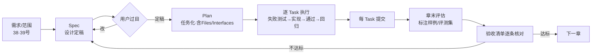

# M7 Agent 开发流程规范（对齐 Mew 智能客服项目的 spec/plan 流程）

日期：2026-11-10，上海时间。
状态：流程规范。本文规定"怎么写、怎么验、怎么提交"，不替代 38/39/40/41/42/43 号的需求与验收口径，也不授权开工、建表、装依赖或调模型。
与 54 号的关系：54 号回答"做什么、什么门槛"，本文回答"按什么节奏做出来"；54 号的阶段划分作为范围依据保留。

## 1. 范本来源与借鉴边界

范本：`D:\Mew智能客服源码\python\docs\superpowers\`（每章一份 `specs/*-design.md` + 一份 `plans/*.md`）与其 README 的"各章长出了什么、怎么验"。

只借鉴它的**流程骨架**，不借鉴它的技术栈与业务：

| 借鉴项 | 具体做法 |
|---|---|
| spec 先行 | 每章先写设计（做/不做、架构、数据模型、接口契约、验收），定稿后才写计划 |
| plan 任务化 | 计划拆成可独立完成、可独立提交的 Task，每个 Task 声明 Files 与 Interfaces |
| 测试先行 | 每个 Task 先写失败测试 → 跑出预期失败 → 才写实现 → 跑通 → 全量回归 → 提交 |
| 纯提示词/模型部分用标注样例评估代替 TDD | 无法用单测锁定的效果，改用人工标注样例 + 评估脚本，报告通过率与失败样本 |
| 每任务一提交 | commit 带章号前缀，单次可回退 |
| 验收清单对照 spec | 章末列可勾选的验收项，逐条有命令或证据 |

不借鉴：它的 LangChain/LangGraph/Milvus 选型、课程式章节节奏、"上游直连不设网关"的做法（本项目必须由 Java 做授权网关）、它的鉴权态度（本项目所有入口必须过企业与会话授权）。

## 2. 适用范围与已核对的前置

适用范围：M7（授权资料问答 → 只读工具 → 受限编排 → 草稿确认）。Java 侧与 Python 侧共用同一套流程。

源码核对结果（2026-11-10）：

- 迁移 V1—V15、27 张表；无任何 `ai_*` 表；无 `com.ai` 包；无 Python 服务。
- `equipment`/`work_orders` 已有 `tenant_id + site_id` 与复合唯一键。
- **M5 成员厂区范围、M6 企业暂停未实现**：`tenants` 只有 `enabled`，无 `tenant_member_site_scopes`。
- 现有异步任务范式：`InventoryExportServiceImpl`（instanceId 租约、条件更新、ownedTasks、独立线程池）。

据此定顺序（2026-11-10 用户确认）：ch01—ch02 只碰资料与企业隔离，**不依赖 M5/M6**，可立即排期；**ch03 起接业务工具，前置条件是 M5 厂区范围先落地**，不保留"仅企业级"的降级选项。M5 未完成前，ch03 及之后的章节不得开工。

## 3. 主流程



两条硬规矩：

1. **没定稿的 spec 不写 plan，没写 plan 不开工。** 发现需求变化，先改 spec 再改 plan，不允许"边写边想"。
2. **不能先写实现再补测试。** 每个 Task 的第一步必须是失败测试，并真的跑出预期失败；跑不出失败说明测试没测到东西。

例外（唯一）：纯提示词、纯模型效果这类无法用断言锁定的部分，允许用"标注样例 + 评估脚本"代替单测，但必须在 plan 里显式写明"本章哪几个 Task 用 eval 代替 TDD"，并给出通过率阈值与失败样本保留要求。

## 4. 目录与命名

```
docs/plan/
  55-M7-Agent开发流程规范.md          ← 本文件
  specs/2026-11-10-ch01-资料问答最小闭环-design.md
  plans/2026-11-10-ch01-资料问答最小闭环.md
  specs/2026-11-xx-ch02-...
  plans/2026-11-xx-ch02-...
```

- spec：`specs/<日期>-ch<NN>-<主题>-design.md`
- plan：`plans/<日期>-ch<NN>-<主题>.md`
- 日期用开工日（上海时间），章号两位；同一章的 spec 与 plan 同名不同目录。
- 章内 Task 编号连续；跨章不续号。

代码目录：

| 侧 | 位置 | 说明 |
|---|---|---|
| Java | `src/main/java/com/ai/` | controller / service / service.impl / client / security / tool / config / mapper |
| Java | `src/main/resources/db/migration/V16__*.sql` 起 | 只新增，不改 V1—V15 |
| Java | `src/main/resources/mapper/Ai*.xml` | 复杂 SQL 才建 XML，简单查询用注解或 LambdaWrapper |
| Python | `ai-service/` | 独立目录、独立虚拟环境、独立 pyproject |
| 前端 | 独立前端仓库 | 按 42 号页面规范接入 |

## 5. 章节划分

章节 = 可独立验收、可独立演示的一段能力，不按技术分层切。

| 章 | 主题 | 对应阶段 | 是否接模型 | 是否接业务表 |
|---|---|---|---|---|
| ch01 | 资料入库与最小闭环（上传→切分→词面检索→引用→任务查询） | AI1.0 前半 | 否 | 否（只碰 `ai_*`） |
| ch02 | 向量检索、引用校验、拒答、评测集 | AI1.0 后半 | 是 | 否 |
| ch03 | 只读工具底座：设备、维修履历 | AI1.1 前半 | 是 | 只读（前置：M5） |
| ch04 | 只读工具扩展：SOP 检索、适配备件、库存、告警 | AI1.1 后半 | 是 | 只读（前置：M5） |
| ch05 | LangGraph Agent Runtime 与工具编排 | AI1.2 | 是 | 只读 |
| ch06 | 故障诊断与历史案例检索（S1/S2） | AI1.3 | 是 | 只读 |
| ch07 | 工单与维修报告草稿、人工确认（S4） | AI1.4 | 是 | 写，且只经确认后 |
| ch08 | 评估、可观测、安全与可靠性 | AI1.5 | — | — |

章节与 AI1.0—AI1.5 一一对应；场景编号 S1—S5 与工具清单见 56 号《定位与场景范围》。

LangGraph/LangChain 的引入依据 56 号第 5 节：多步诊断流程需要状态编排与中断恢复，故 ch05 起使用；31 号"不默认引入"的结论已被该定位覆盖，但"不为用框架而加抽象"仍然有效——图里只放真实存在的节点，不搭空壳。


ch01 先不接模型，是刻意的：三进程通信、任务状态机、租约、取消、引用落库、前端交互这些"架构风险"必须在没有模型噪声时先跑通；否则后面一切失败都分不清是架构问题还是模型问题。

## 6. Spec 模板（逐节必填）

```markdown
# Ch<NN> 设计:<主题>

> 状态:草稿 / 定稿(用户已过目)
> 前置:依赖哪一章/哪个需求已完成
> 依据:38/39/40/41/42/43 号中对应的条款

## 1. 背景与目标
现状问题 + 本章目标 + 一句话架构

## 2. 范围
**做:**(编号列)
**不做(用户明确):**(编号列,写清为什么不做)

## 3. 架构总览与数据流
调用方向、信任边界、失败时的行为

## 4. 基础设施
表 | 目录 | 端口 | 配置项 | 依赖(版本锁) | 凭据来源

## 5. 数据模型
新增表:字段/类型/唯一键/索引;存量表是否受影响

## 6. 接口契约
每个接口:方法+路径、角色、请求体、响应体、状态码、错误码
Java→Python 与 Python→Java 的内部契约单列,注明"不开放给浏览器"

## 7. 关键规则
租户隔离、参数校验、幂等、状态机、资源上限、日志与脱敏

## 8. 验收
可勾选条目,每条绑定命令或证据

## 9. 后续章节依赖
本章为谁提供什么、留给后面什么
```

"不做"必须写"用户明确"或"依据某号文档第几条"，不接受"暂不实现"这种模糊表述。

## 7. Plan 模板

```markdown
# Ch<NN> <主题> 实施计划

**Goal:** 一句话可验收目标
**Architecture:** 本章在整体里的位置与技术形状
**Tech Stack:** 版本锁定
**Spec:** specs/<同名>-design.md

## Global Constraints
- 技术选型定死,走不通停下问,不换方案
- 本章不碰的东西(模型/业务表/工具/前端等)
- 接口与错误码约定
- 测试边界(不打真实模型、不连外部网络、隔离库)
- 提交规范
- 不做清单

### Task 1: <可独立完成的一件事>
**Files:** Create / Modify / Test
**Interfaces:** Produces / Consumes
- [ ] Step 1: 写失败测试
- [ ] Step 2: 跑测试确认失败(写明预期失败信息)
- [ ] Step 3: 实现
- [ ] Step 4: 跑测试确认通过(写明预期通过数)
- [ ] Step 5: 全量回归
- [ ] Step 6: Commit
...

## 验收清单(对照 spec)
- [ ] ...
```

Task 粒度判据：**一个 Task 应该是"能在一次提交里说清楚、能单独回退、不依赖未完成的下一个 Task"的最小单元**。一个 Task 里出现两个业务概念就拆开。

## 8. Task 执行细则

1. **Files 先写清**：新增哪些文件、改哪些文件、测试文件路径。计划里写不出文件路径，说明设计还没想清。
2. **Interfaces 先写清**：本 Task 产出什么签名（方法名、入参、返回、异常），消费谁。后续 Task 只允许依赖这里声明过的接口。
3. **测试只测本 Task 的行为**：断言数量少而准；不写"顺便测一下别的"。
4. **跑不出失败就停**：Step 2 必须真的失败，且失败原因与预期一致（模块不存在 / 断言不通过）。若第一次就通过，先确认测试是否真的覆盖了目标行为。
5. **测试不许为了过而改断言**：确属实现预期变化，先在 plan 里记录变更理由，再改断言。
6. **每 Task 结束跑全量回归**，不只跑本文件。
7. **纯提示词/模型效果用 eval**：给出样例文件、脚本、通过率阈值、失败样本保留位置；阈值不达标不许进下一 Task。

## 9. 提交与分支

- 分支：`ch<NN>-<主题>`，从上一章合并后的基线拉出；不直接在主分支开发。
- 提交：每 Task 一次，message 形如 `feat(ch03): 设备信息只读工具`；只提交本 Task 的 Files。
- 不提交：`.env`、凭据、运行目录、导出文件、评测原始大文件（样例 JSON 可提交）。
- 一次提交只做一件事；格式化和无关重构不混进来。
- 章合并前跑独立审查，审查意见未关闭不合并。

## 10. 与 EquipOps 既有硬规范的衔接

Mew 的项目没有这些约束，本项目有，**冲突时以本项目为准**：

| 既有规范 | 在本流程里的落点 |
|---|---|
| ServiceImpl 先写完整编号执行流程、逐行中文说明 | Task 的"实现"步骤内完成，审查项之一 |
| Flyway 只增量、不改已执行迁移 | 每章迁移版本号在 spec 第 4 节先分配 |
| 统一 `Result{code,message,data,timestamp}`、IPage 分页 | 接口契约按 42 号写，不另创响应格式 |
| 可信身份只从 `CurrentAccessService` 取 | spec 第 7 节与 Task 的 Interaces 必须写明 |
| 企业隔离贯穿 SQL | 每个 List/Detail 接口的测试里必须有跨企业反例 |
| 构建/MySQL/HTTP/浏览器/部署分别记录 | 章末验收清单按此五类分别给证据 |
| 不虚构人天、不虚构通过率 | plan 不填工期；评估报告只写实测值 |

## 11. 验收与证据

每个 Task：测试输出（含失败那一次）+ 提交号。
每章：对照 spec 的验收清单，逐条给命令与结果；AI 相关章额外给评测报告（样例版本、模型名、K、阈值、逐例结果、失败样本）。

硬门槛沿用 43 号：跨企业泄露 0、未授权工具或写入 0、伪造可验证引用 0。任一不为 0，本章不通过，不进入下一章。

## 12. 禁止清单

- 跳过 spec 直接写代码；跳过失败测试直接写实现。
- 一个 Task 里塞多个概念；一次提交夹带无关改动。
- 为了让测试过而放宽断言，或删掉写不出来的断言。
- 用假数据冒充"已联调"；用编译通过冒充验收。
- 在资料问答还没达标时先接工具；在只读工具没跑稳时开写入。
- 把 `tenantId`/`userId` 从请求体当授权；把模型给的工具名当权限。
- 改已执行的迁移、提交凭据、把真实企业资料传给出域未批准的模型。

## 13. 怎么用

1. 按第 5 节确认当前章；若前置未满足（如 ch03 需要 M5），先解决前置或改范围并在 spec 写明。
2. 复制第 6 节模板写 spec，用户过目定稿。
3. 复制第 7 节模板写 plan，逐 Task 执行。
4. 章末按第 11 节出证据，用户签收后进下一章。

已按本规范写好第一章的示例：[设计](specs/2026-11-10-ch01-资料问答最小闭环-design.md) 与 [计划](plans/2026-11-10-ch01-资料问答最小闭环.md)。
