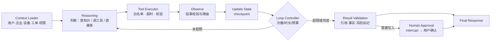

# M7-Agent 定位与场景范围（Industrial Maintenance Agent）

日期：2026-11-10，上海时间。
状态：定位定稿草案，待用户过目。本文确立"AI 模块是 V2.0 的特色模块"，并据此调整 55 号的章节划分与提示词。
依据：38 号 M7-R1/R2、40 号信任边界、41 号数据模型、42 号接口、43 号质量门槛；本轮的定位讨论。

## 1. 定位

| 项 | 结论 |
|---|---|
| 核心定位 | **业务型 Agent**：能调设备、工单、库存、告警工具，辅助维修人员完成一次真实工作，不只是回答知识 |
| 架构 | **混合架构**：Java 负责业务与授权，Python 负责推理、检索与编排 |
| Agent 形态 | **单主 Agent + 多工具**，不做 Multi-Agent、不做通用 Agent 平台 |
| 写入边界 | AI 只产出草稿；所有写入由 Java 重新校验后执行，用户必须确认 |
| 第一价值链路 | 故障诊断 → 备件推荐 → 工单/维修报告草稿 → 人工确认 |

不做（明确排除）：Multi-Agent 集群、通用 Agent 开发平台、自主决策系统、AI 直接执行高风险业务操作、为用新框架而堆叠技术。

## 2. 五个业务场景

| 编号 | 场景 | 用到的能力 | 对应章节 |
|---|---|---|---|
| S1 | AI 故障诊断 | 设备档案 + 维修履历 + 手册/SOP 检索 + 相似案例 + 排查建议 + 安全提示 | ch06 |
| S2 | 历史维修案例检索 | 对已完成工单与维修报告做 RAG，带引用 | ch02、ch06 |
| S3 | Java 业务工具调用 | 只读业务工具 + 需确认的草稿工具 | ch03、ch04、ch07 |
| S4 | AI 工单助手 | 规范化报修内容、故障分类、检查清单、维修报告草稿 | ch06、ch07 |
| S5 | AI 维修知识助手 | 面向全企业的统一问答入口，RAG + 工具 + 业务上下文 | ch02、ch04 |

### S1 诊断输出的固定结构

```
可能故障        （列 2–5 个，按可能性排序，不写"一定"）
风险等级        确定 / 待现场确认 / 无法判断
排查建议        可执行的检查步骤（顺序 + 判据）
推荐备件        来自设备-备件适配关系 + 库存，无适配则明确说明
参考依据        文档引用 + 历史工单编号
安全提示        必须展示
免责声明        "AI 诊断是辅助建议，不是经仪器验证的故障结论"
```

**免责声明不是可选项。** 缺了它，这条链路按缺陷处理。

## 3. 工具清单（工具名固定为 snake_case，与 MCP 兼容形态对齐）

| 工具 | 功能 | 权限 | 章节 |
|---|---|---|---|
| `get_equipment_info` | 查设备档案 | 只读 | ch03 |
| `get_equipment_history` | 查维修历史 | 只读 | ch03 |
| `search_maintenance_sop` | 检索维修规范/手册 | 只读 | ch04 |
| `search_spare_parts` | 查适配备件 | 只读 | ch04 |
| `get_inventory_stock` | 查库存 | 只读 | ch04 |
| `get_active_alarms` | 查设备告警 | 只读 | ch04 |
| `draft_work_order` | 生成工单草稿 | 需人工确认 | ch07 |
| `draft_repair_report` | 生成维修报告草稿 | 需人工确认 | ch07 |

约束：

- 工具名与参数 schema 注册在 Java 侧，Python 只能从"已注册 ∩ 本任务 scope"里选。
- 所有只读工具按 `tenant_id` 过滤；ch03 起还必须叠加 M5 厂区范围。
- 草稿工具只产出草稿，不产生业务写入。
- 工具契约按 MCP 工具形态设计（name/description/inputSchema），但**首版传输走 Java 内部 HTTP 网关**；独立 MCP Server 封装后置，且需用户确认后才做。

## 4. Agent Runtime

沿用"Load Context → Reason → Tool Executor → Observe → Update State → Loop Controller → Final Response / Human Approval"的结构，落到 LangGraph：



工业场景对这套结构的三条额外要求：

1. **不许无限循环**：工具调用次数、总时长、token 预算全部硬上限，Loop Controller 是硬闸。
2. **高风险动作必须中断**：写操作走 `interrupt`，恢复时必须重新校验授权与业务状态。
3. **可追溯**：每步留 taskId、工具名、参数摘要、结果摘要、耗时；不留凭据与正文全文。

## 5. 技术选型（本轮确定）

| 层 | 选型 | 说明 |
|---|---|---|
| 前端 | Vue 3（独立仓库） | 知识助手页、诊断页、草稿确认页 |
| 业务 | Java 17、Spring Boot 4.0.6、MyBatis-Plus、Flyway、MySQL 8、Redis Session | 仍是业务数据唯一可信来源 |
| Agent | Python 3.12、FastAPI、**LangGraph**、**LangChain** | 状态编排与模型/工具集成 |
| 模型 | OpenAI 兼容协议直连上游，`CHAT_*` 配置 | 换供应商不改代码 |
| 检索 | 向量索引 + 引用回取 | 索引可删重建，按企业隔离 |
| 状态 | LangGraph checkpoint（本地文件），按 tenant/user/task 隔离 | 不是权限凭证，不进业务库 |
| 工具 | Java 内部 HTTP 网关 + MCP 兼容契约 | 独立 MCP Server 后置 |
| 观测 | 结构化日志 + 任务成本表 | 先够用，不上 Langfuse |

选型约束：以上为定死项；发现矛盾或走不通，停下来问，不自行替换。

## 6. 与既有规划的关系

- 38 号 M7-R1/R2 的边界不变：资料问答先行、只读工具其次、写入仅草稿且需确认。
- 31 号"不默认引入 LangGraph/MCP"的结论**被本轮定位覆盖**：LangGraph 因多步诊断流程而引入；MCP 只做到契约兼容，不先建 Server。
- 55 号流程规范与各章提示词按本文调整。
- M5 厂区范围仍是 ch03 起的硬前置，不因定位提升而放宽。

## 7. 风险

| 风险 | 处理 |
|---|---|
| 诊断结论被当成仪器结论 | 强制免责声明 + 风险等级字段 + 页面固定展示 |
| 多步编排放大越权面 | 每步重新查库、工具白名单、scope 绑定、上限硬闸 |
| checkpoint 泄露上下文 | 按 tenant/task 隔离、不存凭据、不进业务库、可删 |
| 场景铺太宽做不完 | 一条主链路（S1→备件→草稿）先做扎实，其余按价值排 |
| 知识来源混杂导致编造 | 引用必须反查 chunk，历史工单按单号引用，不可引用不存在的东西 |
